<p align="center">
  
</p>

#  Logo Kit SVG

Agent skill that ships a **four-file SVG brand system** (icon + README banner, static + animated) plus an optional **tiered brand kit** (`lite` / `medium` / `full`). Workflow: brief → research (`search_library` / `search_examples`) → concepts → checkpoint (explore mode) → kit → four README assets → **script QA**. Colors come from the project's **real** theme tokens, not an invented palette.

For identity-only brainstorming without the fixed 904×256 README blueprint, see [logo-design-skill](https://github.com/kaankiziltug/logo-design-skill).

First production run: [ApplyDiff](https://github.com/pahlevikun/applydiff) (git diff for your CV). The session asked for plain + animated brand assets; it ended with four files and a visual QA gate.

## Install

Install with a compatible agent-skills CLI (`npx skills add`, and similar):

##### npm

```bash
# Standalone repo (canonical name; formerly repo-logo-svg)
npx skills add pahlevikun/logo-kit-svg

# Monorepo path — replace <owner>/<repo> with your fork
# Folder on disk may still be repo-logo-svg until renamed:
npx skills add <owner>/<repo>/src/own-skills/repo-logo-svg
# Future monorepo path after rename:
# npx skills add <owner>/<repo>/src/own-skills/logo-kit-svg
```

##### pnpm

```bash
pnpm dlx skills add pahlevikun/logo-kit-svg
# or monorepo (current folder name):
pnpm dlx skills add <owner>/<repo>/src/own-skills/repo-logo-svg
```

After install, enable the skill in your agent; it loads [SKILL.md](SKILL.md) automatically (`name: logo-kit-svg`).

### Cursor plugin

From a clone of this repo (or after publishing to GitHub):

1. Open **Cursor Settings → Rules / Plugins** (or install from a local plugin path).
2. Point at this directory — metadata lives in [.cursor-plugin/plugin.json](.cursor-plugin/plugin.json).
3. The skill root is `./` (`skills: "./"`).

### Claude Code marketplace

```bash
claude plugin marketplace add /path/to/logo-kit-svg/.claude-plugin/marketplace.json
claude plugin install logo-kit-svg@logo-kit-svg
```

Marketplace manifest: [.claude-plugin/marketplace.json](.claude-plugin/marketplace.json).

### Codex plugin

Install from the repo root using [.codex-plugin/plugin.json](.codex-plugin/plugin.json) (same layout as [polyglot-copywriter](https://github.com/pahlevikun/polyglot-copywriter)).

### Manual install (symlink)

When you do not use a skills CLI:

| Tool | Typical skill path |
|---|---|
| Claude Code | `~/.claude/skills/logo-kit-svg/` |
| Cursor user skills | `~/.cursor/skills/` or your Agent Store `skills/logo-kit-svg/` |
| Codex / other | Follow that tool's skill directory convention |

```bash
git clone https://github.com/pahlevikun/logo-kit-svg.git
ln -sf "$(pwd)/logo-kit-svg" ~/.claude/skills/logo-kit-svg
```

Optional slash command (Claude Code):

```bash
cp commands/logo-kit-svg.md ~/.claude/commands/
```

That exposes `/logo-kit-svg`. Legacy `/mark-kit-svg` → [commands/mark-kit-svg.md](commands/mark-kit-svg.md) (alias only).

## Use it

In a repo that already has a theme file:

> Create a plain and animated SVG brand kit for this repo — icon and README banner — and embed both in the README.

Invoke the **logo-kit-svg** skill ([SKILL.md](SKILL.md)) or `/logo-kit-svg` if you installed the command; optional explore mode or `lite` / `medium` / `full` kit tier per [references/process.md](references/process.md).

The skill routes per [references/process.md](references/process.md), reads tokens ([references/token-table.md](references/token-table.md)), researches [references/library-guide.md](references/library-guide.md), fills [templates/logo-brief.md](templates/logo-brief.md), then runs mandatory scripts in [references/xml-and-qa-gate.md](references/xml-and-qa-gate.md).

### Base vs additional outputs

**Always:** four files in `assets/` (icon + banner, static + animated). **Kit** under `assets/kit/` (orchestrate with `scripts/kit_build.py`, gate with `scripts/validate_kit.py`):

| Artifact | Script | Typical path |
|----------|--------|--------------|
| Mono / reversed | `scripts/export_variants.py` | `assets/kit/icon-mono.svg`, `icon-reversed.svg` |
| **Platform (required)** | `scripts/export_platform_icons.py` | `platform/web/` (favicon.ico + manifest), `platform/android/`, `platform/ios/` — [references/platform-icon-contracts.md](references/platform-icon-contracts.md) |
| **Social (required, SVG + PNG)** | `scripts/social_cards.py --png` | `assets/kit/social/*` |
| Concept sheet (medium+) | `scripts/concept_sheet.py` | `assets/kit/concept-sheet.svg` |
| Tiles board (medium+) | `scripts/tiles_board.py` | `assets/kit/tiles-board*.svg` |
| Preview sheet (medium+) | `scripts/preview_sheet_lite.py --kit-dir assets/kit` | `preview_sheet_lite.html` |
| Presentation board (full) | `scripts/presentation_board.py` | `presentation-board.html` |

**Opt-in:** gallery PNGs in `docs/images/` via `render_png.py` — [references/deliverables.md](references/deliverables.md).

### Kit tiers

| Tier | Extra deliverables |
|------|---------------------|
| **lite** | Mono/reversed + **platform** + **social** (always) |
| **medium** | lite + preview sheet + concept/tiles SVGs |
| **full** | medium + presentation board |

Details: [references/brand-kit-tiers.md](references/brand-kit-tiers.md).

### What you get in the target repo

| File | Size | Role |
|---|---|---|
| `assets/icon.svg` | 512 × 512 | Square mark |
| `assets/icon-animated.svg` | 512 × 512 | Same mark, ~4.6s loop |
| `assets/logo.svg` | 904 × 256 | README banner (3-column layout) |
| `assets/logo-animated.svg` | 904 × 256 | Same banner, ~6s loop |

README embed pattern:

```html
<p align="center">
  
</p>

#  Brand
```

## What the ApplyDiff session threw out

<p align="center">
  
</p>

| Cut | Why it failed | Fix |
|---|---|---|
| Horizontal stripes | Background looked like a screensaver | Flat `--bg` fill |
| Pill ending on `W` | `CLI · TUI · Web` clipped | `width = chars × 7.2 + 32` |
| Amber-only hunks | Removed vs added looked the same | Semantic red `-` / green `+` when column 3 is `diff-hunks` ([banner-column-3.md](references/banner-column-3.md)) |
| Wordmark-only banner | Product story missing | 3-column mark + copy + live diff card |

Receipt: [examples/applydiff/brief.md](examples/applydiff/brief.md). Static/animated files: [examples/applydiff/](examples/applydiff/).

<p align="center">
  
</p>

## Repository layout

This skill repo splits **its own branding** from the **agent reference shelf**:

| Path | Role |
|------|------|
| `examples/logo-kit-svg/` | **This skill’s branding** — README embed, `profile.svg`, four base SVGs + `kit/` (concepts, platform, social, …). |
| `examples/applydiff/` | Reference run (anti-patterns + fixed four files). |
| `examples/mdz/` | Second reference run: four review rounds, each cut on a measured defect (grid-like hash, double frame, phone-like page). |
| `library/` | **Study shelf for agents** — curated trademark/OSS SVGs, `catalog.json`, `gallery.html`, etc. Never ship these into target repos. |

**Target repos** you run the skill against still use `assets/` for their four README SVGs ([references/deliverables.md](references/deliverables.md)).

```
logo-kit-svg/                    # skill id; folder may still be repo-logo-svg on disk
├── SKILL.md
├── commands/logo-kit-svg.md     # optional /logo-kit-svg slash wrapper
├── commands/mark-kit-svg.md     # deprecated alias → same skill
├── library/                     # study-only shelf + generated catalog
├── references/                  # blueprints, QA, process, kit tiers
├── templates/                   # logo-brief, brand-guidelines, presentation spec
├── examples/logo-kit-svg/       # skill brand + full kit shipment
├── examples/applydiff/          # reference shipment + catalog.json
├── scripts/                     # audit, render_qa, search_*, kit exporters
├── tools/smoke_test.py
├── evals/evals.json
└── tests/
```

## Former skill ids (migration)

| Former | Use instead |
|--------|-------------|
| `repo-logo-svg`, `mark-kit-svg`, `mark-svg` (skill id) | **`logo-kit-svg`** — [SKILL.md](SKILL.md) |
| Slash `/mark-kit-svg` | Alias → [commands/mark-kit-svg.md](commands/mark-kit-svg.md); prefer **`/logo-kit-svg`** |
| Monorepo folder `repo-logo-svg` on disk | OK until renamed; skill id is still **logo-kit-svg** |

## Validation

From the skill root:

```bash
python3 tools/smoke_test.py
```

Library maintainers: `python3 scripts/sync_library.py --clone` then `python3 scripts/build_catalog.py` (regenerates `catalog.json`, `classifications.json`, `stats.json`, `gallery.html`). Shelf layout mirrors [logo-design-skill `assets/library`](https://github.com/kaankiziltug/logo-design-skill/tree/main/skills/logo-design/assets/library); see [references/library-guide.md](references/library-guide.md) and [CONTRIBUTING.md](CONTRIBUTING.md).

## License

[MIT](LICENSE). Copyright (c) 2026 F Y Pahlevi.
